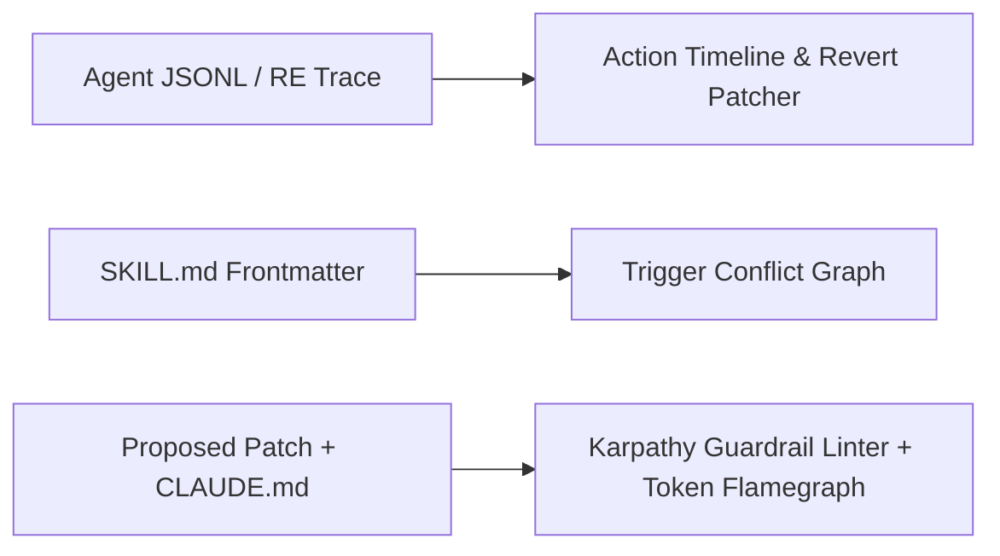

# agent-hud

[](https://aetherx86.github.io/agent-hud/)
[](plugin/SKILL.md)
[](LICENSE)

> **Universal Agent Skill, Action Timeline & Guardrail Mission Control.**

## Covered Top-50 GitHub Ecosystems
| Ecosystem | Capability in `agent-hud` |
| :--- | :--- |
| `openclaw`, `AutoGPT`, `opencode`, `claw-code` | Live Action Timeline HUD with DOM/diff state cards and 1-click unified revert patches |
| `rea`, `deepseek-harness` | Binary reverse-engineering Mach-O / Pseudo-C / Xref inspection trace replay |
| `superpowers`, `ECC`, `hermes-agent`, `mattpocock/skills`, `anthropics/skills` | Interactive `SKILL.md` trigger collision & subagent handoff topology graph |
| `andrej-karpathy-skills` | Diff guardrail linter flagging unrequested file touches, premature abstractions, and token bloat flamegraph |

## 1-Step Plugin Install (`SKILL.md` + CLI Hook)
```bash
node plugin/cli.mjs --demo --json
```
Copy `plugin/SKILL.md` into your agent's skills directory to activate guardrail auditing.

## Architecture

